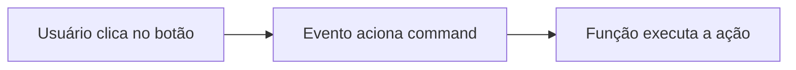
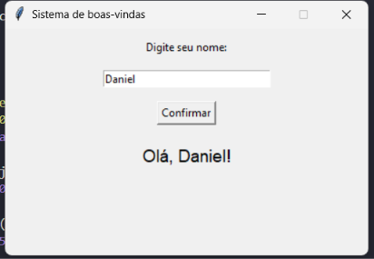

# Tópico 02 - Introdução ao Desenvolvimento Desktop com Python e Tkinter

## Objetivos da aula

Ao final desta aula, o aluno deverá ser capaz de:

- Compreender o que é desenvolvimento desktop;
- Criar e utilizar ambientes virtuais em Python;
- Gerenciar bibliotecas e dependências com o `pip`;
- Desenvolver interfaces gráficas utilizando Tkinter;
- Manipular componentes gráficos e eventos;
- Capturar e apresentar informações fornecidas pelo usuário.

## 1. O que é Desenvolvimento Desktop?

O desenvolvimento desktop consiste na criação de aplicações executadas diretamente no computador do usuário, sem a necessidade de um navegador.

Diferentemente dos programas que desenvolvemos até agora, nos quais utilizamos o terminal para receber e apresentar informações, as aplicações desktop permitem interagir com o usuário por meio de uma **Interface Gráfica (GUI — Graphical User Interface)**.

- **CLI (Command Line Interface):** interação por comandos e textos no terminal.
- **GUI (Graphical User Interface):** interação por janelas, botões e campos de texto.

São exemplos de aplicações desktop: calculadoras, editores de texto, sistemas de estoque, ferramentas de automação e sistemas de gestão empresarial.

O Python possui diversas bibliotecas para o desenvolvimento dessas aplicações:

| Biblioteca    | Característica                                                                 |
| ------------- | ------------------------------------------------------------------------------ |
| Tkinter       | Simples, integrante da biblioteca padrão do Python e indicada para iniciantes. |
| CustomTkinter | Baseada no Tkinter, com aparência mais moderna.                                |
| PyQt          | Interfaces avançadas utilizando o framework Qt.                                |
| PySide6       | Biblioteca oficial do Qt para Python.                                          |
| wxPython      | Interfaces com aparência semelhante à do sistema operacional.                  |

Nesta aula, utilizaremos o **Tkinter** para compreender os fundamentos da construção de interfaces gráficas.

## 2. Ambientes Virtuais (venv)

Um ambiente virtual é um espaço isolado que permite instalar bibliotecas e dependências específicas para cada projeto, sem interferir nos demais projetos ou na instalação global do Python.

Imagine que temos dois sistemas que utilizam versões diferentes de uma mesma biblioteca. Sem ambientes virtuais, essas versões poderiam entrar em conflito. Com um ambiente virtual para cada projeto, ambos podem funcionar independentemente.

### 2.1. Criando um ambiente virtual

Dentro da pasta do projeto, execute:

```bash
py -m venv .venv
```

No Linux ou macOS, utilize `python3 -m venv .venv`.

Será criada uma pasta chamada `.venv`, responsável por armazenar o ambiente virtual e suas dependências.

### 2.2. Ativando o ambiente virtual

**Windows — CMD:**

```cmd
.venv\Scripts\activate
```

**Windows — PowerShell:**

```powershell
.\.venv\Scripts\Activate.ps1
```

**Windows — Git Bash:**

```bash
source .venv/Scripts/activate
```

**Linux/macOS:**

```bash
source .venv/bin/activate
```

Após a ativação, o terminal normalmente apresentará a indicação `(.venv)` antes do caminho do projeto.

Para desativar o ambiente, basta executar:

```bash
deactivate
```

## 3. Gerenciamento de Bibliotecas (pip)

Uma biblioteca é um conjunto de códigos e funcionalidades prontas que podemos reutilizar em nossos programas.

O `pip` é o gerenciador de pacotes do Python, responsável por instalar, atualizar e remover bibliotecas.

| Comando                                      | Finalidade                           |
| -------------------------------------------- | ------------------------------------ |
| `python -m pip install biblioteca`           | Instalar uma biblioteca.             |
| `python -m pip uninstall biblioteca`         | Remover uma biblioteca.              |
| `python -m pip list`                         | Listar bibliotecas instaladas.       |
| `python -m pip install --upgrade biblioteca` | Atualizar uma biblioteca.            |
| `python -m pip freeze > requirements.txt`    | Exportar as dependências do projeto. |
| `python -m pip install -r requirements.txt`  | Instalar as dependências do projeto. |

O arquivo `requirements.txt` permite que outros desenvolvedores instalem as mesmas versões das dependências utilizadas no projeto.

### 3.1. Verificando o Tkinter

O Tkinter normalmente já acompanha a instalação padrão do Python no Windows. Para verificar se está disponível, execute:

```bash
python -m tkinter
```

Caso uma janela seja aberta, a biblioteca está funcionando corretamente.

> [!NOTE]
> O Tkinter não precisa ser instalado pelo pip. Em algumas distribuições Linux, como Ubuntu e Debian, pode ser necessário instalar o pacote `python3-tk` pelo gerenciador de pacotes do sistema.

## 4. Criando nossa primeira interface gráfica

Os componentes de uma interface gráfica são chamados de **widgets**. Botões, campos de texto, rótulos e outros elementos visuais são exemplos de widgets.

Crie um arquivo chamado `main.py` e escreva o seguinte código:

```python
import tkinter as tk

janela = tk.Tk()

janela.title("Minha primeira aplicação")
janela.geometry("400x300")

janela.mainloop()
```

Execute o programa:

```bash
python main.py
```

### Entendendo o código

| Código                 | Finalidade                                          |
| ---------------------- | --------------------------------------------------- |
| `import tkinter as tk` | Importa a biblioteca Tkinter.                       |
| `tk.Tk()`              | Cria a janela principal.                            |
| `title()`              | Define o título da janela.                          |
| `geometry()`           | Define a largura e a altura da janela.              |
| `mainloop()`           | Mantém a aplicação em execução, aguardando eventos. |

O `mainloop()` é responsável por manter a janela aberta e processar as interações do usuário, como cliques, digitação e movimentação do mouse.

## 5. Principais componentes do Tkinter

| Widget        | Finalidade                                |
| ------------- | ----------------------------------------- |
| `Label`       | Exibe textos ou imagens.                  |
| `Button`      | Executa uma ação.                         |
| `Entry`       | Entrada de texto de uma linha.            |
| `Text`        | Entrada de texto com várias linhas.       |
| `Checkbutton` | Permite marcar uma opção.                 |
| `Radiobutton` | Permite selecionar uma opção de um grupo. |
| `Frame`       | Agrupa outros componentes.                |

Os exemplos a seguir devem ser inseridos antes de `janela.mainloop()`.

### 5.1. Label — Rótulo

Utilizado para apresentar textos ou imagens na interface.

```python
rotulo = tk.Label(
    janela,
    text="Bem-vindo ao sistema!",
    font=("Arial", 14),
    fg="blue"
)

rotulo.pack(pady=20)
```

### 5.2. Entry — Campo de entrada

Utilizado para receber informações digitadas pelo usuário. Funciona de maneira semelhante ao `input()` que utilizamos no terminal.

```python
entrada = tk.Entry(janela, width=30)

entrada.pack(pady=10)
```

Para recuperar o conteúdo digitado, utilizamos o método `get()`, normalmente dentro de uma função acionada pelo usuário:

```python
nome = entrada.get()
```

### 5.3. Button — Botão

Utilizado para executar uma função quando o usuário realiza um clique.

```python
def exibir_mensagem():
    print("Botão clicado!")


botao = tk.Button(
    janela,
    text="Clique aqui",
    command=exibir_mensagem
)

botao.pack(pady=10)
```

Observe que passamos a função `exibir_mensagem` sem os parênteses no parâmetro `command`. Dessa forma, a função será executada somente quando o usuário clicar no botão.

### 5.4. Propriedades dos componentes

| Propriedade | Finalidade                           |
| ----------- | ------------------------------------ |
| `text`      | Define o texto do componente.        |
| `font`      | Define a fonte e o tamanho do texto. |
| `fg`        | Define a cor do texto.               |
| `bg`        | Define a cor de fundo.               |
| `width`     | Define a largura do componente.      |
| `height`    | Define a altura do componente.       |
| `command`   | Define uma função a ser executada.   |
| `padx`      | Define um espaçamento horizontal.    |
| `pady`      | Define um espaçamento vertical.      |

As propriedades disponíveis e suas unidades variam conforme o tipo de widget. Nos gerenciadores de layout, `padx` e `pady` definem espaçamentos externos.

## 6. Posicionamento dos componentes

O Tkinter possui três gerenciadores de layout, responsáveis por organizar os componentes dentro da interface: `pack()`, `grid()` e `place()`.

### 6.1. Utilizando pack()

Organiza os componentes automaticamente, geralmente em sequência. É indicado para interfaces mais simples.

```python
rotulo.pack(pady=10)
entrada.pack(pady=10)
botao.pack(pady=10)
```

### 6.2. Utilizando grid()

Organiza os componentes em uma estrutura de linhas e colunas, semelhante a uma planilha. É especialmente útil para formulários.

```python
rotulo = tk.Label(janela, text="Nome:")
rotulo.grid(row=0, column=0, padx=10, pady=10)

entrada = tk.Entry(janela)
entrada.grid(row=0, column=1, padx=10, pady=10)
```

### 6.3. Utilizando place()

Permite posicionar os componentes em coordenadas específicas da janela.

```python
rotulo.place(x=20, y=30)
entrada.place(x=100, y=30)
```

> [!WARNING]
> Não utilize `pack()` e `grid()` simultaneamente dentro de um mesmo contêiner. Entretanto, é possível utilizar gerenciadores diferentes em contêineres distintos, como os Frames. Teste os exemplos de layout separadamente.

## 7. Programação orientada a eventos

Até agora, desenvolvemos programas que executavam instruções sequencialmente. Em interfaces gráficas, trabalhamos também com a **programação orientada a eventos**.

Nesse modelo, o programa aguarda uma interação do usuário para executar determinada ação.



Por exemplo, em um sistema de cadastro, o programa não deve cadastrar um usuário automaticamente ao ser iniciado. Ele deve aguardar até que o usuário preencha os campos e clique no botão "Cadastrar".

## 8. Exemplo prático — Capturando informações do usuário

Vamos desenvolver uma aplicação que recebe o nome do usuário e apresenta uma mensagem personalizada na interface.

```python
import tkinter as tk


def cumprimentar():
    nome = entrada.get()

    if nome.strip() == "":
        resultado.config(text="Informe seu nome!")
    else:
        resultado.config(text=f"Olá, {nome}!")


janela = tk.Tk()

janela.title("Sistema de boas-vindas")
janela.geometry("400x250")
janela.resizable(False, False)

rotulo = tk.Label(janela, text="Digite seu nome:")
rotulo.pack(pady=10)

entrada = tk.Entry(janela, width=30)
entrada.pack(pady=5)

botao = tk.Button(
    janela,
    text="Confirmar",
    command=cumprimentar
)

botao.pack(pady=10)

resultado = tk.Label(janela, text="", font=("Arial", 14))
resultado.pack(pady=10)

janela.mainloop()
```

### Resultado esperado



Neste exemplo, utilizamos conhecimentos que já desenvolvemos anteriormente, como variáveis, funções, condicionais e manipulação de strings, mas agora aplicados a uma interface gráfica.

Também utilizamos três novos métodos:

| Método        | Finalidade                                         |
| ------------- | -------------------------------------------------- |
| `get()`       | Recupera o conteúdo de um campo.                   |
| `config()`    | Altera as propriedades de um componente existente. |
| `resizable()` | Define se a janela pode ser redimensionada.        |

---

# Exercícios

## Exercício 01 — Minha primeira aplicação

Desenvolva uma aplicação desktop que apresente uma janela com as seguintes características:

- Título: "Minha Aplicação";
- Dimensões: 300x200 pixels;
- Redimensionamento desabilitado;
- Um rótulo centralizado com o texto "Olá, mundo!".

## Exercício 02 — Contador de cliques

Desenvolva uma aplicação que possua um botão e um rótulo. A cada clique no botão, incremente um contador e atualize o rótulo apresentando a quantidade de cliques realizados.

```text
+----------------------------+
| Contador de cliques        |
+----------------------------+
|         Cliques: 0         |
|       [ Clique aqui ]      |
+----------------------------+
```

## Exercício 03 — Formulário de cadastro

Crie um formulário utilizando o gerenciador de layout `grid()`. O formulário deverá possuir campos para nome, idade e e-mail, além de um botão "Cadastrar".

Ao clicar no botão, verifique se todos os campos foram preenchidos e apresente as informações cadastradas em um rótulo na própria interface.

## Exercício 04 — Calculadora simples

Crie uma aplicação que receba dois valores numéricos e possua quatro botões, um para cada operação matemática: soma, subtração, multiplicação e divisão.

O resultado deverá ser apresentado na própria interface. Não se esqueça de validar os valores informados e impedir divisões por zero.

```text
+---------------------------------+
| Calculadora simples             |
+---------------------------------+
| Primeiro valor: [ 10          ] |
| Segundo valor:  [ 5           ] |
|                                 |
|    [ + ] [ - ] [ * ] [ / ]      |
|                                 |
|          Resultado: 15          |
+---------------------------------+
```

## Exercício 05 — Desafio: Cadastro de personagens

Desenvolva uma interface gráfica para cadastrar personagens de um RPG. Cada personagem deverá possuir nome, classe, nível e quantidade de pontos de vida.

Ao clicar no botão "Cadastrar personagem", o programa deverá validar as informações, adicionar o personagem a uma lista e apresentar os personagens cadastrados na interface.

> [!TIP]
> Utilize os conhecimentos de Programação Orientada a Objetos para criar uma classe `Personagem` e instanciar um novo objeto a cada cadastro.
